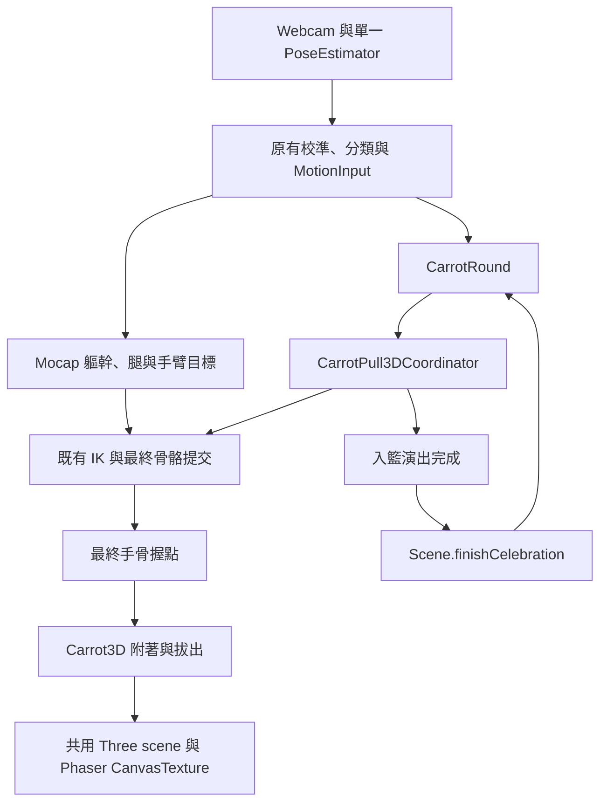

# Task 4D-2 完整即時 3D Carrot Pull

更新日期 2026-11-13。交付範圍為正式 Webcam 入口、輔助抓握、連續拔出、入籃與五輪完成。本文記錄程式實作、合成輸入驗證及尚待真人確認的部分。

**Human Webcam QA: NOT VERIFIED**

## 1. 架構與主要檔案

正式 Webcam 流程保留原有單一影像推論排程、個人舒適幅度校準、動作分類與 Mocap。`Rabbit3DPreview` 現在管理 `sprite`、`3d-game` 及 `3d-debug` 三種用途。其原有公開 `mode` 仍使用 `3d`／`sprite`，新的 `purpose` 區分遊戲與開發預覽，讓既有呼叫者繼續工作。



| 檔案 | 職責 |
| --- | --- |
| `src/game/scenes/CarrotPullScene.ts` | 輸入、原有回合、玩家 UI、唯一計分呼叫與場景清理 |
| `src/game/3d/Rabbit3DPreview.ts` | 模式選擇、資源、Mocap、遊戲協調與安全回退 |
| `src/game/3d/gameplay/CarrotPull3DCoordinator.ts` | 輔助接近、附著、連續拔出、入籃及控制權 |
| `src/game/3d/gameplay/carrotGameConfig.ts` | 有界距離、角度與演出時間 |
| `src/game/3d/gameplay/CarrotPull3DEnvironment.ts` | 可達種植位置的高架花槽與可見泥土前景 |
| `src/game/3d/Carrot3D.ts` | 原 GLB、世界握點、物件專用泥土裁切平面 |
| `src/game/3d/interaction/CarrotAttachmentController.ts` | 原中點附著，以及可選的主手附著 |
| `src/game/3d/ThreeOverlay.ts` | 單一 Three renderer、裁切範圍及渲染前最終手部取樣 |
| `src/game/3d/CarrotGameDebug.ts` | DEV 遊戲資料面板與鍵盤模擬旗標 |
| `src/style.css` | 3D 遊戲 HUD、窄屏與最大角色比例的遮擋調整 |
| `scripts/qa-carrot-game.mjs` | 校準、五輪、故障、資源、正式版本與佈局驗證 |
| `tests/CarrotPull3DCoordinator.test.ts`、`tests/CarrotSoil.test.ts` | 真實 GLB 協調、附著、回合與泥土測試 |

## 2. 正式入口與 CarrotRound

玩家由首頁進入拔蘿蔔並選擇開啟鏡頭後，自動選用 `3d-game`。偵測人物、原有站立／舒適淺屈膝校準及站立參考完成後開始遊戲。Keyboard 保留 Sprite 遊戲。WebGL、GLB 或有限接近失敗時會顯示「暫時未能顯示立體阿兔，已轉用原有遊戲畫面。」並繼續 Sprite 流程。

`CarrotRound.ts` 沿用原程式。預設屈膝保持 650 ms、站立保持 500 ms，仍讀取既有設定與個人校準。回合依序經過 `READY → BENDING → GRABBED → RETURNING → SUCCESS → NEXT_ROUND`，第五次成功進入 `COMPLETE`。

Scene 在 3D 尚未就緒或輔助抓握尚未完成時暫停回合進度。`GRABBED`／`RETURNING` 需要實際建立附著後才繼續站立保持。`SUCCESS` 等候收穫演出完成。`finishCelebration(source)` 保留唯一的 `model.completeCelebration()` 呼叫，檢查目前模式、暫停、追蹤及場景存活狀態，再更新原有分數、進度與籃子。

## 3. Assisted Grab

玩家完成原有穩定淺屈膝後，自動開始有限接近。採用左主手握持，右手繼續跟隨玩家。這項遊戲輔助使用最終手掌握點及有界 IK，單目 Webcam 的手部深度仍由遊戲約束補足。

| 階段 | 行為 |
| --- | --- |
| `PLANTED` | 原有 Mocap 控制角色，蘿蔔保持種植位置 |
| `REACHING` | 主手由目前 Mocap 目標平滑接近，設定時間 0.45 s |
| `ALIGNING` | 實際握點進入 0.12 模型單位內後，以原附著控制器進行 0.2 s 對齊 |
| `ATTACHED` | 蘿蔔跟隨當幀最終主手骨骼，起身逐步拔出 |
| `LIFTING` | 原回合已成功，等候拔出進度與附著穩定 |
| `TRANSFERRING` | 釋放手部、0.9 s 入籃，主手在 0.35 s 內混回 Mocap |
| `HARVESTED` | 隱藏本棵 3D 蘿蔔，送出一次收穫完成通知 |

接近期間最多等候 3 s。無法進入有界附著範圍時只送出一次安全回退通知。回退在該幀渲染結束後處理，避免處理已釋放的 renderer。程式保持距離檢查啟用，正式流程全程自動。

## 4. IK 控制權與即時混合

每幀由 Mocap 先設定一般姿勢，Coordinator 再覆寫主手目標，既有 IK／插值最後提交一次真實骨骼。`afterPose` 讀取完成提交後的手骨，更新蘿蔔，再交由同一 Three renderer 繪製。

| 時段 | 主手控制 | 其餘控制 |
| --- | --- | --- |
| READY／BENDING | Mocap | Mocap |
| 接近 | 目前 Mocap 目標混合至輔助目標 | 軀幹、頭、腿、Root 與右手持續 Mocap |
| 握持與拔出 | 有界主手握持及小幅來源貢獻 | 軀幹、頭、腿、Root 與右手持續 Mocap |
| 釋放前 0.35 s | 由握持目標混回當前 Mocap | 其餘持續 Mocap |
| 其後 | Mocap | Mocap |

接近目標為 raise 55°、elbow 0°、plane 140°。拔出逐步移向 raise 100°、elbow 0°、plane 130°。握持保留來源 raise 最多 ±3°、plane 最多 ±2°、elbow 最多 2° 的貢獻。動作使用現有 V3 耦合範圍、求解器與插值。角色的軀幹、腿部、側傾及有限平移持續由玩家輸入驅動。

## 5. 可達性與場景位置

原地面握點超出現有短臂舒適淺屈膝的範圍。本階段將種植區改為高架花槽，並將獨立蘿蔔的統一比例設為 0.4。初始化時以真實 V3 骨骼、淺屈膝及上述接近目標量度主手握點，設定花槽後恢復中立姿勢，畫面顯示前完成量度。

以下距離來自真實 GLB 與 Chrome 合成動作記錄，單位均為模型單位。

| 項目 | 數值 |
| --- | --- |
| 原肩至地面握點 | 1.792283 |
| 原主手握點至地面握點 | 1.181531 |
| 實測上臂加前臂骨鏈 | 0.752250 |
| 加上手掌握點偏移的最大長度上界 | 0.863982 |
| 新種植握點 `(x,y,z)` | `(0.271324, 1.137927, 0.502471)` |
| 新肩至握點 | 0.831712 |
| 新肩至手腕 | 0.752250 |
| 泥土平面 Y | 1.112927 |
| 首次建立附著前的實際接觸距離 | 0.106631 |
| 對齊距離上限 | 0.12 |
| 對齊階段最大單幀握點位移 | 0.006221 |
| 穩定附著握點誤差 | 0 |
| 穩定握持時主手／另一隻手至握點 | 0／1.224298 |

附著使用最後 0.106631 的小幅視覺對齊，完成時間 0.2 s。此方案改變花槽構圖與主手控制，玩家仍使用原有個人舒適淺屈膝範圍。右手保留獨立活動，與蘿蔔的距離另外記錄。這是輔助抓握遊戲機制。

真實骨骼測試亦覆蓋舒適屈膝、±10° 側傾、6° 前傾與有限 Root 偏移。刻意組合極端側傾、前傾及 Root 位移的案例會進入一次有界回退。

## 6. 連續拔出

`pullProgress` 由抓取時的 `bendAmount` 記錄、當前連續起身幅度及原 `RETURNING` 站立保持進度共同決定。取得握點後才允許拔出，增長速度限制為完整行程至少 0.65 s。

視覺進度採單調保留。`RETURNING` 重新屈膝會按照原規則回到 `GRABBED`，保留同一棵蘿蔔、原附著與已拔出的距離。再次站直後接續。原狀態機仍需穩定站立才進入 `SUCCESS`，完整拔出後才開始入籃。

## 7. 泥土與 3D／Phaser 分層

Rabbit 與 Carrot 共用透明 Three CanvasTexture，Phaser depth 為 40。高架花槽使用原土壤圖片與簡單木架 Graphics，土壤後層 depth 30、木架 depth 42、可見前唇 depth 42.1。前唇的裁切以原圖片 opening center 249 px 為準。

`Carrot3D` 的材質使用世界 +Y 裁切平面，種植時根部在泥土平面以下的片段被裁掉。角色材質沿用原設定。起身時同一棵 3D 根部逐步穿過固定平面顯露，入籃開始時已完全離土即可移除裁切。離開遊戲與物件釋放時會還原原材質裁切設定。

Chrome 種植畫面像素檢查記錄土面下橙色像素為 0。拔出後可見橙色像素由 64 增至 503。畫面檢視涵蓋 READY、握持、根部完全拔出、籃子前景及下一棵，未見明顯重複物件或土壤遮擋錯置。

## 8. 籃子與計分

原 `BASKET_DROP_TARGET` 經 `phaserToRabbitWorld` 轉換為同一正交投影的 Three 世界座標。原有 2D 籃子保留。3D 蘿蔔從實際放手位置沿 smoothstep 路徑及 0.6 高度弧線，在 0.9 s 內移到籃子。

抵達後隱藏本棵 3D 蘿蔔，通知 Scene 呼叫原 `completeCelebration()`，原 Basket 依分數顯示內容。Coordinator 設有每輪一次通知，Preview 的 generation 與 Scene 存活狀態另有防護。Sprite 與 3D 回呼皆檢查目前模式，故障回退與離場會取消舊 3D 演出。

## 9. 五輪與下一輪

DEV 與正式建置均完成第 1 至第 5 棵。最後畫面顯示 `分數：5`、`進度：5 / 5` 及原完成介面。第五次通知進入 `COMPLETE`，停止附著寫入並隱藏種植蘿蔔。

每輪重設既有附著物件、Carrot transform、泥土裁切、主手暫時目標及 `pullProgress`。相機、校準、Mocap、Rabbit GLB、Carrot GLB、WebGL renderer 與動態材質持續重用。五輪觀察為一條相機 stream、一個推論 model、每種 GLB 各載入一次。完成後可重新開始或回首頁。

## 10. Tracking Lost 與恢復

遊戲需要現有可靠追蹤狀態、有效站立參考、最新 Mocap frame，並檢查 frame 距今不超過 250 ms。完成初次就緒後失去可靠追蹤會凍結整個遊戲渲染姿勢、IK、接近／拔出／入籃時間及回合進度。

保留分數、校準、既有附著與演出時間。右下角顯示現有人物狀態，可靠 frame 恢復確認後由原位置繼續。一般追蹤遺失沿用等候流程。

## 11. Pause、重新校準與清理

Pause 同時暫停 MotionInput、Mocap、Coordinator、附著、Phaser timer 與 tween。接近、拔出及入籃的暫停／恢復均有 Chrome 檢查。期間收到的 Mocap frame 不改寫角色。Resume 保留原進度，並等待可靠追蹤。

主動重新校準保留分數，重用現有相機與模型。Restart／Home 會取消 fetch、提升 generation、移除事件與開發面板、釋放附著／花槽／Carrot／Mocap、移除 Phaser texture、釋放 Three renderer 並關閉影像輸入。測試包含入籃中 WebGL 故障、Carrot GLB 失敗與 pending load 時回首頁。

## 12. 性能與資源

Chrome 157 合成動作實測使用真實 GLB、原相機取得、推論排程與渲染，Landmarker 輸出由可重現 fixture 提供。

| 指標 | 本次結果 |
| --- | --- |
| 觀察遊戲渲染率 | 60.06 FPS |
| 觀察推論排程率 | 19.74 FPS |
| IK 計算平均／p95 | 0.143／0.200 ms |
| Coordinator 計算平均／p95 | 0.035／0.100 ms |
| 自動接近加附著實際活動時間 | 0.66664 s |
| GIF 觀察拔出時間 | 0.7000 s |
| 入籃設定時間 | 0.9 s |
| 五輪 renderer 資源 | 31 geometries、2 textures，各輪保持一致 |
| 動態 texture | 一張，五輪保持同一資源 |

遊戲裁切為 `(574,119,820,660)`，共 541,200 pixels。每張 RGBA surface 為 2,164,800 bytes，比原 520² 多約 100.15%，比 Task 4D-1 640×700 多約 20.8%。同一 renderer、Mocap 推論排程與場景繼續重用。當前量度下渲染接近 60 FPS。

已檢查角色比例 0.5／1／1.5 的真實 GLB 接近、拔出與籃子軌跡裁切。額外最大比例檢查在 1512×982、600×800 確認耳朵、頭部、提示、分數與暫停按鈕的矩形互不遮擋。3D HUD 移除重複遊戲名稱與步驟列。

以上 fixture 的推論時間與排程數據只描述此合成輸出場景。真實 MediaPipe 執行及真人動作的結果分開記錄。

## 13. 自動測試與 Chrome QA

新增 43 個 Coordinator 測試與 6 個土壤／渲染測試，使用實際 Rabbit／Carrot GLB 與 Three 骨骼實例。獨立覆核已執行這 49 項並全數 PASS。覆蓋原回合保持、提前取消、中途模式加入、可達與不可達、獨立支援手、連續拔出、回彈、唯一回呼、五輪界線、追蹤、暫停、釋放及材質還原。

| 驗證 | 結果 |
| --- | --- |
| 原有 260 項加新增 49 項完整測試 | PASS 309／309 |
| `npm run typecheck`、`npm run build` | PASS |
| `qa:carrot-game` DEV 完整流程 | PASS 28 checks，含最大比例佈局 |
| `qa:carrot-game` 最大比例補充佈局 | PASS 1 check，兩個 viewport |
| `qa:carrot-game` 正式建置 | PASS 7 checks |
| 既有 `qa:rabbit3d`，含完整五棵 Sprite | PASS 15 checks |
| 既有 `qa:mocap` | PASS 22 checks |
| 既有 `qa:ik` | PASS 11 checks |
| 既有 `qa:rig-v3` | PASS 7 checks |
| 既有 `qa:carrot-grab` | PASS 23 functional checks，加獨立性能模式 3 checks |
| 既有 `qa:mocap-engine` | PASS，真正本地 WASM／模型與空鏡頭 121 frames |
| 既有 `qa:berry`、`qa:berry-camera` | PASS，各 7 checks |
| 真人 Webcam | NOT VERIFIED |

DEV 28 checks 包含自動校準、連續即時動作、未達閾值、原保持、取消、輔助接近、回彈、逐步露根、入籃、重新校準、五輪、沒有第六棵、資源重用、Pause、追蹤遺失與恢復、重新開始、WebGL／GLB 故障及離場。正式建置亦由相機入口完成五輪，驗證開發 query 不顯示技術控制、Keyboard 保持 Sprite、回首頁釋放模型與相機、故障提示可見且原遊戲可繼續。

機讀記錄保存在 [遊戲報告](qa/task-4d2/gameplay-report.json)、[正式建置報告](qa/task-4d2/production-report.json) 及 [最大比例佈局報告](qa/task-4d2/layout-report.json)。單元與建置記錄見 [unit-tests.txt](qa/task-4d2/unit-tests.txt) 及 [build.txt](qa/task-4d2/build.txt)，舊功能機讀證據保存在 [regression](qa/task-4d2/regression/)。

使用已安裝 Chrome 與 Playwright 執行。完整測試透過原 Camera／PoseEstimator scheduler、校準、分類、Mocap、CarrotRound 及最終骨骼，fixture 只提供確定性 Landmarker 輸出。正式建置版本只替換動態 MediaPipe module 的推論輸出。另行執行的真實空鏡頭 WASM／模型平均推論為 16.18 ms。刻意中斷模型載入產生的網路診斷獨立記錄，正式遊戲報告要求其餘錯誤為空。

### 重跑命令

先以 `npm run dev -- --port 5178 --strictPort` 啟動，再執行下列命令。`QA_OUTPUT` 應使用絕對暫存路徑。

```sh
npm run typecheck
npm test
npm run build
QA_URL=http://127.0.0.1:5178/ QA_OUTPUT=/private/tmp/motion-garden-4d2-qa npm run qa:carrot-game
QA_LAYOUT_ONLY=1 QA_URL=http://127.0.0.1:5178/ QA_OUTPUT=/private/tmp/motion-garden-4d2-layout npm run qa:carrot-game
```

正式建置以 `npm run preview -- --port 5179 --strictPort` 啟動後執行。

```sh
QA_PRODUCTION=1 QA_URL=http://127.0.0.1:5179/ QA_OUTPUT=/private/tmp/motion-garden-4d2-production npm run qa:carrot-game
```

### 畫面與連續證據

以下畫面均為實際 Phaser 渲染，輸入為可重現合成動作。GIF 包含 45 幀、4.5 s 的單輪動作，狀態文字為觀察標示。

| 狀態 | 證據 |
| --- | --- |
| READY | [01-ready.png](qa/task-4d2/01-ready.png) |
| BENDING | [02-bending.png](qa/task-4d2/02-bending.png) |
| GRABBED | [03-grabbed.png](qa/task-4d2/03-grabbed.png) |
| RETURNING | [04-returning.png](qa/task-4d2/04-returning.png) |
| SUCCESS | [05-success.png](qa/task-4d2/05-success.png) |
| 入籃 | [06-basket-arrival.png](qa/task-4d2/06-basket-arrival.png) |
| COMPLETE | [07-complete.png](qa/task-4d2/07-complete.png) |
| 最大比例桌面／窄屏 | [1512 px](qa/task-4d2/layout-scale1.5-1512.png)、[600 px](qa/task-4d2/layout-scale1.5-600.png) |
| 連續完整單輪 | [full-round.gif](qa/task-4d2/full-round.gif) |

## 14. 目前限制與開發操作

- **Human Webcam QA: NOT VERIFIED**。真人深度、動作延遲、抖動、遮擋與長者可用性需要實際參與者驗證。
- 主手附著為遊戲輔助。另一隻手保留即時跟隨，手指姿態與握力未建模。極端合併姿勢可能超出可達範圍，會安全回退。
- 現有 V3 耦合姿勢與頭部幾何限制繼續適用。當前畫面檢查覆蓋既定流程與指定姿勢，所有可能姿勢的碰撞尚未驗證。
- 性能記錄來自本機 Chrome 157，Safari、Firefox、目標 Mini-PC、TV 與其他裝置尚待驗證。
- 既有 AudioManager 音效與語音 hooks 仍為靜音。

DEV 可使用 `?carrotGameDebug=1` 查看回合、分數、屈膝／站立保持進度、IK 手目標、接觸距離、附著、拔出、泥土、籃子、控制權、追蹤與 FPS。`?carrotGameDebug=1&carrotGameSim=1` 啟用完整 3D 鍵盤模擬，`↓/S` 屈膝、`↑/W` 站立、Esc 暫停，仍經原 MotionInput、CarrotRound 與 Coordinator。

舊 `?rabbit3dDebug=1&mocapDebug=1&carrotGrabDebug=1` 保留獨立骨骼／抓握預覽及原測試放置。正式建置只呈現玩家介面。

## 15. 真人測試指引

1. 在實際遊戲入口開啟鏡頭，讓全身與雙膝持續留在畫面，完成原有自然站立與舒適淺屈膝校準。
2. 自然站立時活動雙臂、側傾及小幅移動，核對相應骨骼持續跟隨。等待與校準期間記錄任何錯誤進度。
3. 依提示慢慢淺屈膝並保持，檢查主手自動接近、蘿蔔握點連續及土壤根部遮擋。
4. 慢慢企直，檢查起身時逐步露根、穩定站立後入籃及分數恰好增加一次。中途再輕屈膝一次，檢查同一棵蘿蔔保留已拔出距離。
5. 分別在接近、拔出與入籃時按 Pause，再恢復。短暫走出畫面，檢查人物提示、凍結與返回後接續。
6. 連續完成五棵，核對 `5 / 5`、完成介面、重新開始與返回首頁。檢查相機使用指示在離場後結束。
7. 記錄裝置、瀏覽器、鏡頭高度與距離、成功／失敗步驟、FPS、可達性、延遲及畫面問題。測試報告需註明真人驗證時間與參與情境。

Task 4D-2 到此交付。後續真人與裝置驗證依獨立授權安排。
